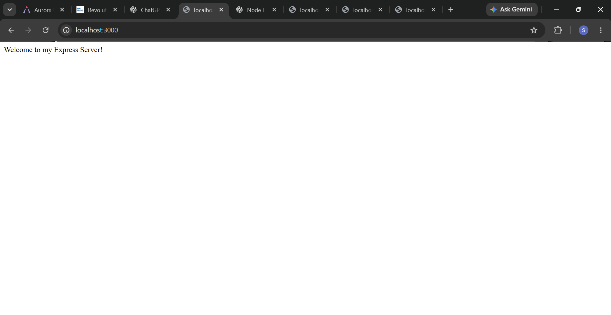
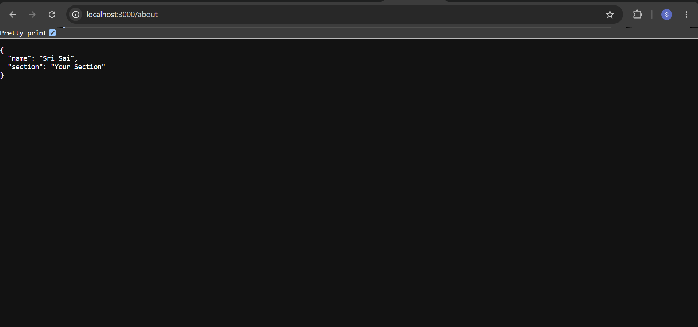
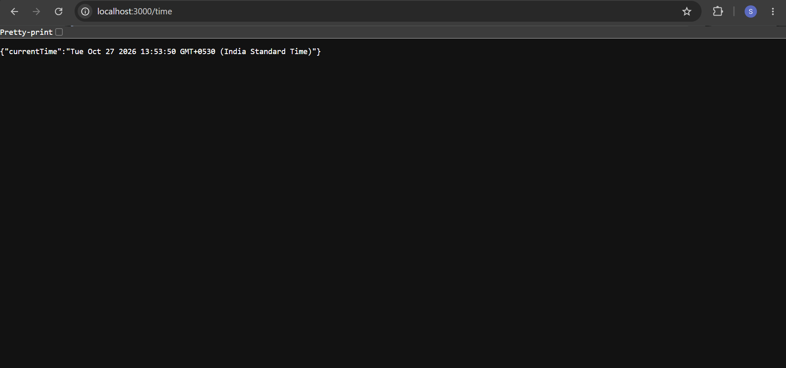
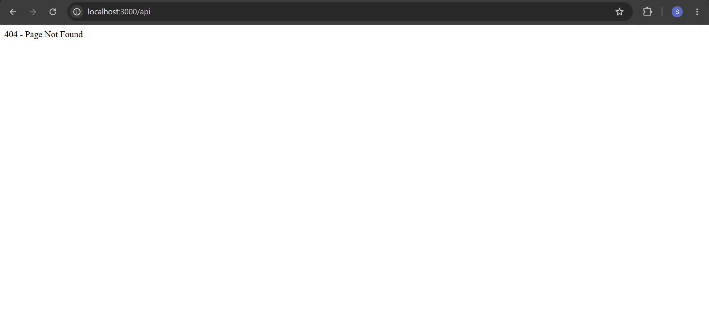
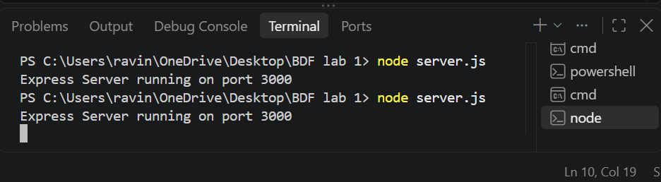
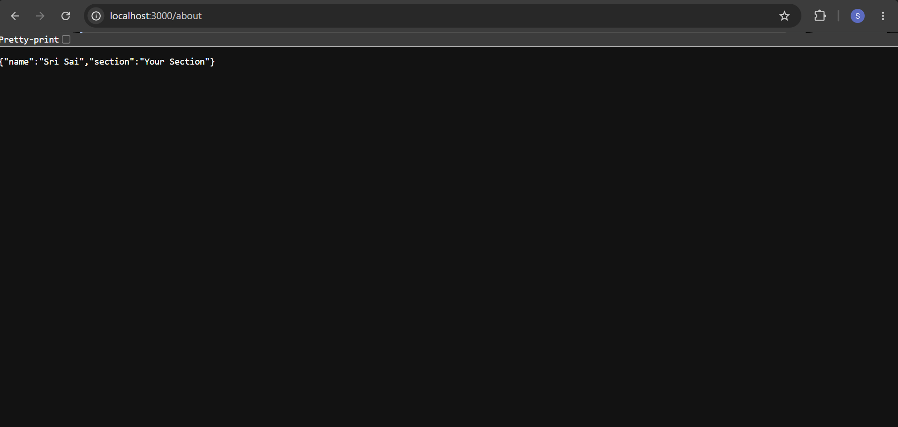

# Lab 1: Node.js and Express Server

## Student Details

- **Name:** SriSai
- **Registration Number:** 252U1R1046
- **Section:** CSE 2A
- **Lab:** Lab 1 – Node.js and Express Server

## Deployment Link

**Public Deployment URL:** To be added after deployment.
## GitHub Repository

**Repository URL:** [Bukka-Sri-Sai](https://github.com/srisaibukka/Bukka-Sri-Sai)

## Objective

The objective of this lab is to understand the fundamentals of Node.js and Express.js by creating a server, handling HTTP requests, and sending responses through API endpoints.

## Technologies Used

- Node.js
- Express.js
- JavaScript
- npm
- Git
- GitHub

## Installation

1. Clone the GitHub repository.

```bash
git clone YOUR_GITHUB_REPOSITORY_URL
```

2. Open the project directory.

```bash
cd "BDF lab 1"
```

3. Install the required dependencies.

```bash
npm install
```

## Execution

Run the server using:

```bash
node plainServer.js
```

The server runs on port `3000`.

Open the following URL in a browser:

```text
http://localhost:3000
```

## API Endpoints

### GET /

- **Method:** GET
- **Endpoint:** `/`
- **URL:** `http://localhost:3000/`
- **Status Code:** `200 OK`
- **Response:** `Hello`
- **Content-Type:** `text/plain`
## Project Structure

```text
Bukka-Sri-Sai/
├── screenshots/
│   ├── 404-not-found.png
│   ├── about.png
│   ├── endpoint-response.png
│   ├── home.png
│   ├── server-running.png
│   └── time.png
├── .gitignore
├── README.md
├── package.json
├── package-lock.json
├── plainServer.js
└── server.js
```
### Home Endpoint


### About Endpoint


### Time Endpoint


### 404 Not Found



### Server Running



### API Endpoint Response

## Notes

- The server runs on port `3000`.
- The root endpoint `/` returns `Hello`.
- The response content type is `text/plain`.
- The `node_modules` folder is excluded from GitHub using `.gitignore`.
- The public deployment URL will be added after deployment.

## Conclusion

This lab provided practical experience with Node.js server creation, HTTP request handling, API endpoints, npm package management, and GitHub-based project submission.